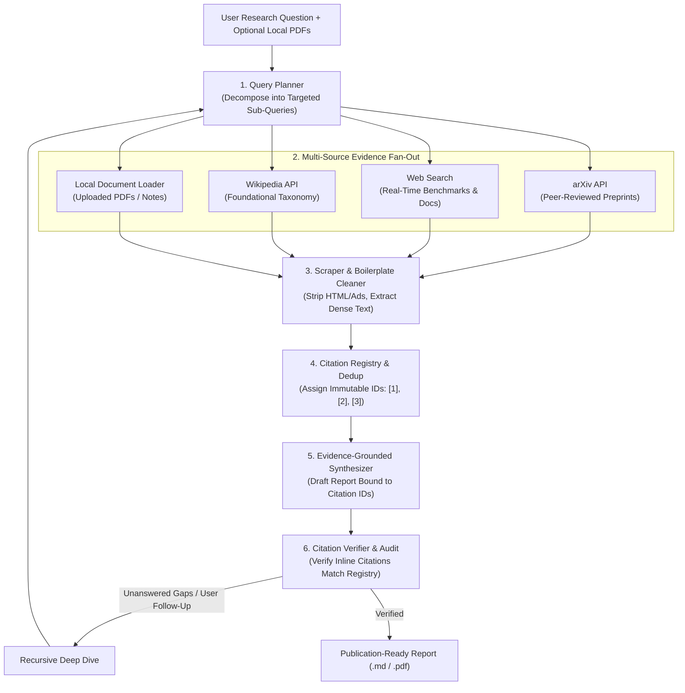

# A3 — Research Agent: Core Architectural Concepts

> "Deep research is not a single search query passed to an LLM. It is an iterative loop of query decomposition, multi-source evidence retrieval, noise stripping, cross-verification, and citation-grounded synthesis."

---

## 1. Why Single-Shot Search Fails at Deep Research

When developers first build a "search-enabled assistant," they typically write a linear pipeline:

```python
# The Naive Single-Shot Search Anti-Pattern
results = web_search(user_question)
prompt = f"Answer {user_question} using these results: {results}"
answer = llm(prompt)
```

For simple factual lookups (*"What is the capital of France?"*), this works. For deep technical or scientific research (*"Compare FlashAttention-2 memory scaling against standard self-attention and identify hardware bottlenecks on consumer GPUs"*), it fails systematically:

1. **Query Myopia**: A complex research prompt contains multiple orthogonal sub-questions. Passing the raw prompt to a search engine yields low-recall, surface-level SEO articles instead of primary academic papers or benchmarks.
2. **Context Window Pollution**: Raw web pages are 70–90% HTML boilerplate (navigation menus, cookie banners, ads, footer links). Stuffing uncleaned pages into the context window wastes token budget and degrades attention over real facts.
3. **Citation Hallucination**: When asked to provide sources without a deterministic citation registry, LLMs frequently fabricate plausible-looking URLs, mix up paper authors, or attribute claims to the wrong source.
4. **Single-Source Bias**: Relying only on web search misses peer-reviewed preprints (`arXiv`), foundational definitions (`Wikipedia`), and proprietary user documents (`Local PDFs`).

---

## 2. The 6-Stage Deep Research Pipeline

The [Autonomous Deep Research Agent](https://github.com/tradertanmay/research-agent) replaces single-shot search with a structured 6-stage architecture:



---

## 3. Stage-by-Stage Engineering Breakdown

### Stage 1: Query Decomposition
Instead of searching the user's raw question verbatim, the **Planner** decomposes the topic into specialized queries tailored to each source modality:
- **Academic Query (`arXiv`)**: Targets formal terminology, algorithms, and empirical scaling laws.
- **Empirical / Industry Query (`Web`)**: Targets real-world engineering benchmarks, library implementations, and production postmortems.
- **Foundational Query (`Wikipedia`)**: Establishes baseline mathematical definitions and historical context.
- **Document Query (`Local Vault`)**: Extracts domain-specific constraints from user-uploaded PDFs or markdown notes.

### Stage 2: Multi-Source Evidence Fan-Out
Each source type has distinct failure modes and latency characteristics. Executing searches across `arXiv`, `DuckDuckGo`, `Wikipedia`, and `Local Uploads` concurrently ensures high recall and cross-domain triangulation.

### Stage 3: Boilerplate Stripping & Context Hygiene
Directly applying the principles from **Module 07 — Context Engineering**, the HTML scraper removes:
- `<script>`, `<style>`, `<nav>`, `<footer>`, `<aside>`, and `<header>` blocks.
- Cookie consent banners, newsletter popups, and social share widgets.
- Duplicate whitespace and low-density link lists.

Only high-density paragraphs are retained and truncated to a strict per-source character budget before entering the synthesis window.

### Stage 4: Deterministic Citation Registry
Before the LLM sees a single piece of evidence, the runtime assigns every deduplicated source an immutable integer key (`[1]`, `[2]`, `[3]`, ...) in a deterministic **Citation Registry**:

```python
@dataclass(frozen=True)
class SourceRecord:
    citation_id: int          # e.g., 1 -> referenced as [1]
    source_type: str          # "arxiv" | "web" | "wikipedia" | "local_pdf"
    title: str
    url_or_path: str
    authors_or_domain: str
    cleaned_excerpt: str
```

The model is never asked to type out URLs from memory during synthesis. Instead, the model is instructed to cite facts solely by their integer key (`[1]`), and the runtime deterministically renders the bibliography from the registry. This eliminates fabricated URLs by construction.

### Stage 5: Citation-Grounded Synthesis & Verification
Once the synthesizer produces the structured report (Executive Summary, Comparative Matrix, Key Findings, Bottlenecks), a deterministic **Citation Verifier** audits the output:
1. Extracts all inline `[N]` markers using regular expressions.
2. Verifies that every `[N]` exists in the `CitationRegistry` (no out-of-bounds or phantom citations like `[99]`).
3. Measures **Source Utilization Rate** (what percentage of gathered high-relevance sources were synthesized) and flags any ungrounded sections.

### Stage 6: Interactive Q&A and Recursive Deep Dive
Research rarely ends with the first report. After reviewing the initial synthesis, the user can:
- Ask targeted follow-up questions against the gathered evidence context.
- Trigger a **Recursive Deep Dive**, which identifies unresolved technical gaps in the current report, plans second-hop search queries, retrieves new evidence, and appends a verified addendum.

---

## 4. Capability Gating & Guest Isolation

Applying **Module 12 — Agent Safety and Verification**, when a local research agent is shared over a network or tunnel:
- **Host vs. Guest Role Separation**: Localhost requests retain full administrative capabilities, while remote visitors are automatically assigned a restricted `Guest` role.
- **Vault Privacy**: The host's personal saved reports and past conversation history are isolated from guests.
- **Secret Protection**: Endpoints that read or modify API keys (`/api/settings/keys`) enforce strict origin/role preconditions, returning `403 Forbidden` to non-host callers.

---

## 5. Concluding Axiom

> **"An LLM generates plausible prose; a Research Agent constructs verifiable evidence. Without query planning, noise stripping, and strict citation binding, autonomous research is just confident hallucination."**
